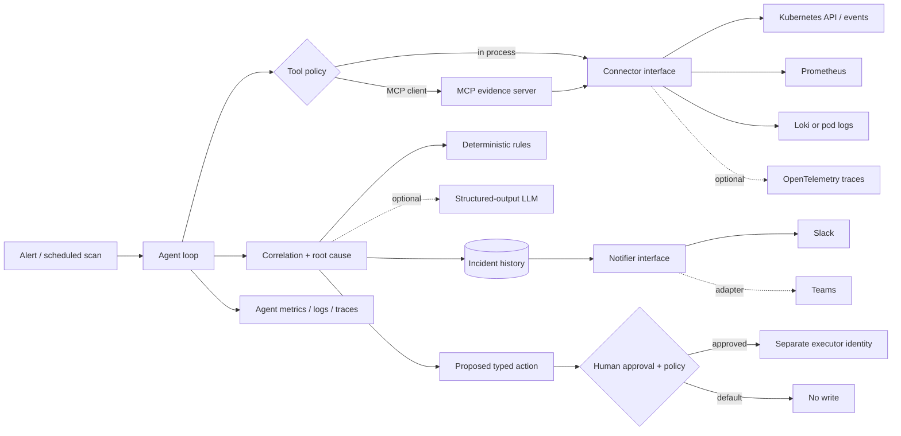

# SRE Agent Lab

A hands-on, production-minded learning project for building an AI-assisted SRE investigator. It detects a symptom, gathers bounded evidence through tools, correlates signals, drafts a cited root-cause hypothesis and remediation plan, records the incident, and reports it to ChatOps.

The default path is fully local and deterministic—no cluster, cloud account, LLM key, or Slack workspace required. Real Kubernetes, Prometheus, Loki, Slack, MCP, and an optional structured-output LLM adapter are layered behind small interfaces.

> Safety model: evidence tools are read-only. Remediation is dry-run by default, lives behind a separate command, requires explicit human approval, and accepts only allowlisted typed actions. Never grant the investigator write-capable Kubernetes credentials.

## Run this first

Requirements: Python 3.11+.

```bash
cd sre-agent
python3 -m venv .venv
.venv/bin/pip install -e '.[dev]'
.venv/bin/sre-agent investigate --scenario crashloop
.venv/bin/pytest -q
```

Try the other incident replays:

```bash
for scenario in oomkilled high_cpu service_5xx deployment_regression dns_failure dependency_latency; do
  .venv/bin/sre-agent investigate --scenario "$scenario"
done
.venv/bin/sre-agent history
```

Or use Docker: `docker compose run --rm agent investigate --scenario crashloop`.

## What the demo teaches

The agent loop is explicit rather than hidden in a framework:

1. **Observe:** a detector returns an initial alert signal.
2. **Plan:** a reasoner chooses the next bounded, read-only evidence tool.
3. **Act:** the connector invokes the tool and returns structured signals.
4. **Reflect:** the loop deduplicates evidence and decides whether to gather more.
5. **Diagnose:** deterministic rules or a swappable LLM produce a cited hypothesis.
6. **Report:** an incident is persisted and sent through a notifier interface.
7. **Remediate:** a separate approval gate may authorize an allowlisted action.

MCP is the protocol boundary for exposing tools to external agents. A connection supplies transport and credentials to a service. A plugin packages capabilities such as MCP servers, skills, or app connections for installation. They complement one another: MCP standardizes tool exchange, connections establish access, and plugins make the integration distributable.

## Architecture



Key interfaces are `TelemetryProvider`, `Reasoner`, `Notifier`, and `ActionExecutor`. This keeps vendors and agent frameworks replaceable. The offline `RuleReasoner` is also a dependable baseline for evaluating an LLM rather than assuming the model improved the system.

## Repository map

```text
src/sre_agent/
  agent.py                 explicit observe/tool/diagnose/report loop
  models.py                typed incident, evidence, finding, and action contracts
  connectors/              mock, Kubernetes, Prometheus, and Loki adapters
  providers/               deterministic and optional LLM reasoning; ChatOps adapters
  mcp_server/server.py     stdio MCP server exposing read-only evidence tools
  guardrails.py            dry-run, approval, and command allowlist policy
  state.py                 append-only local incident history
  observability.py         Prometheus metrics for the agent itself
examples/incidents/        seven realistic replay fixtures
tests/                     behavior, correlation, and safety-policy tests
docs/                      curriculum and production-hardening checklist
```

## MCP: run and connect

```bash
.venv/bin/pip install -e '.[mcp]'
.venv/bin/sre-mcp
```

The server uses stdio and exposes `detect_incidents`, `get_kubernetes_events`, `get_pod_statuses`, `query_prometheus`, and `query_logs`. Point an MCP-capable client at `.venv/bin/sre-mcp`; a generic configuration shape is in `examples/mcp-client-config.json`. The teaching server reads fixtures so experiments cannot mutate a cluster. Extend its connector behind the same tools when moving to a lab cluster.

## Real cluster mode

Use a non-production lab context first:

```bash
.venv/bin/pip install -e '.[kubernetes]'
cp .env.example .env
kubectl config current-context
.venv/bin/sre-agent investigate --real
```

Set `SRE_NAMESPACE`, `SRE_PROMETHEUS_URL`, and `SRE_LOKI_URL` in `.env`. The Kubernetes adapter loads in-cluster config first, then your kubeconfig. Give its service account only `get`, `list`, and `watch` on pods, pods/log, events, deployments, and replicasets. The real detector currently starts from Kubernetes events/status; production deployments should add Alertmanager/webhook ingestion and durable queuing.

Loki is optional: `query_logs` supports a pod-log path in the provider contract. OpenTelemetry traces are intentionally a phase-3 exercise: add a `TraceProvider` returning `Signal` objects, and wrap `SREAgent.investigate` plus connector calls in spans.

## Slack and Teams

For a Slack incoming webhook:

```bash
export SRE_SLACK_WEBHOOK_URL='set-this-locally-never-commit-it'
.venv/bin/sre-agent investigate --scenario service_5xx --output slack
```

`SlackWebhookNotifier` only knows `send(Incident)`. A Teams implementation uses the same interface, keeping the agent independent of ChatOps vendors. For production, use blocks/adaptive cards, thread updates, deduplication, delivery retries, and secret-manager injection.

## Optional LLM provider

Local rules are the default. To use the optional adapter:

```bash
.venv/bin/pip install -e '.[llm]'
export SRE_LLM_PROVIDER=openai
export SRE_LLM_MODEL='your-structured-output-capable-model'
export SRE_LLM_API_KEY='set-locally'
.venv/bin/sre-agent investigate --scenario dependency_latency
```

The LLM receives bounded, labeled evidence and returns the typed `Finding` schema. Telemetry is explicitly treated as untrusted because logs can contain prompt injection. Executable actions are still generated only by deterministic policy. To add another vendor, implement the `Reasoner` protocol; the agent loop and incident schema do not change.

## Approval-gated remediation

An investigation may propose a command, but cannot execute it. The default proves the barrier:

```bash
.venv/bin/sre-agent remediate INCIDENT_ID --approve anything
# blocked: SRE_DRY_RUN=true
```

For a disposable lab only, set `SRE_DRY_RUN=false` and configure `SRE_APPROVAL_TOKEN`; then pass the matching token. A real design should replace shared tokens with an authenticated ChatOps approval record tied to the user, incident ID, exact action hash, expiry, and audit trail. The write executor should run under a separate short-lived identity.

## Agent observability and evaluation

Use `--metrics` to expose Prometheus counters and latency on `:9464` during a long-running integration. The current CLI is one-shot, so a production worker should keep the metrics server alive. Instrument each tool with OpenTelemetry and attach `incident.id` to logs/spans.

The fixture tests are the seed evaluation set. Track detection recall, hypothesis top-k accuracy, evidence citation coverage, unsafe-action rate, tool failure recovery, latency, and model cost. Never promote a prompt/model change without replaying frozen incidents and adversarial logs.

## Build phases

| Phase | Runnable outcome | Main files |
|---|---|---|
| 1 | Python loop investigates fixtures | `agent.py`, `connectors/mock.py` |
| 2 | Tools exposed over MCP | `mcp_server/server.py` |
| 3 | Cluster and telemetry reads | `connectors/kubernetes.py`, `prometheus.py`, `loki.py` |
| 4 | Correlated root-cause finding | `providers/rules.py`, optional LLM adapter |
| 5 | Console/JSON/Slack report | `providers/notifiers.py` |
| 6 | Approval-gated typed action | `guardrails.py`, `executors.py` |
| 7 | Replay tests and hardening | `tests/`, `docs/PRODUCTION.md` |

Work through [the staged curriculum](docs/CURRICULUM.md), then use [the production checklist](docs/PRODUCTION.md) for the capstone.

## Deliberate MVP limits

- JSONL history is excellent for learning, not concurrent production writes.
- Detection is one-shot; production needs Alertmanager/webhook intake, queues, and idempotency.
- Rules use keyword evidence; production correlation needs time windows, topology, revisions, and negative evidence.
- The Slack adapter posts plain text and does not update incident threads.
- Trace ingestion and Teams are extension points, not fake implementations.
- The command executor is suitable only for a disposable lab and remains unreachable by default.

No credentials or cluster data are included. Keep `.env` uncommitted and treat every log, event, MCP result, and model response as untrusted input.
